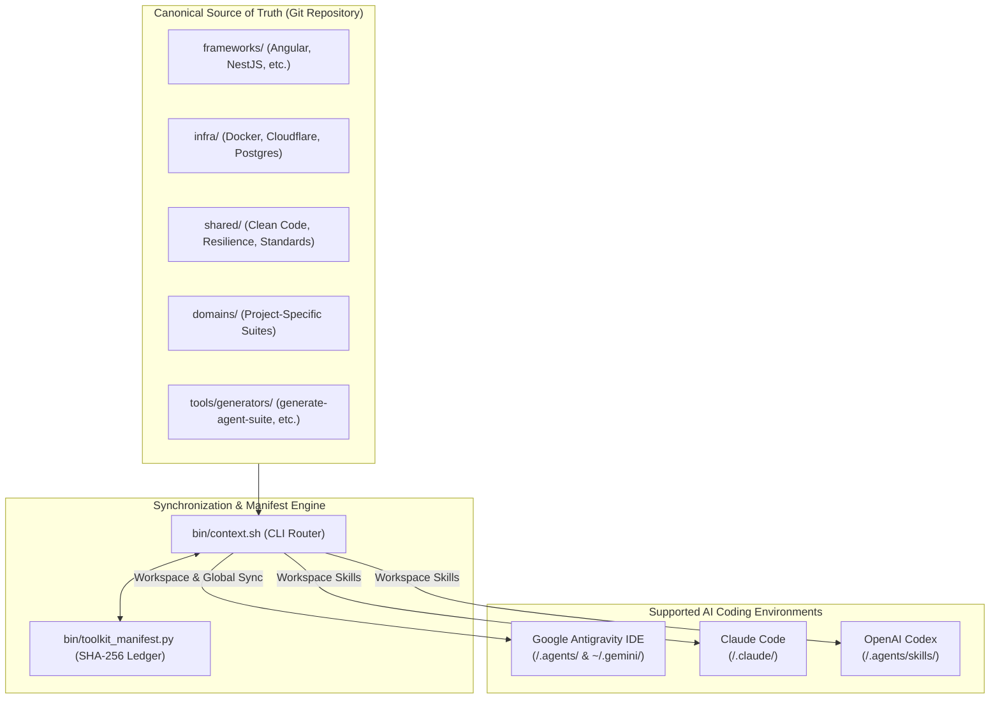
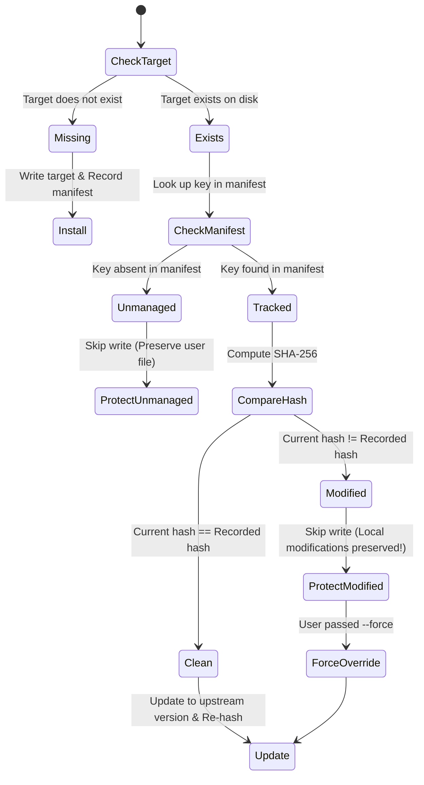

# AI Agent Toolkit Architecture (`docs/ARCHITECTURE.md`)

## 1. Executive Overview

**`ai-agent-toolkit`** is a unified, version-controlled developer context management toolkit and synchronization engine. It establishes a single source of truth for **Agent Skills** (adhering to the [`agentskills.io`](https://agentskills.io) open standard), strict **Behavioral Rules**, and reusable engineering knowledge.

The toolkit addresses the industry-wide problem of **context drift, token bloat, and fragmented developer instructions** across AI coding environments.



---

## 2. Core Architectural Separation

The repository enforces a strict boundary between three distinct layers:

1. **The Consumer Catalog (`frameworks/`, `infra/`, `shared/`, `domains/`)**:
   - Reusable, production-grade skills and rules meant to be synchronized into user projects.
   - Synchronized by default using shorthand, path selectors, or curated presets (`-p angular-spa`, `-p nestjs-api`).
2. **Toolkit Authoring Tools (`tools/generators/`)**:
   - Internal meta-tooling used to scaffold, validate, evaluate, and audit the toolkit itself (`generate-agent-suite`, `generate-skill`, `generate-rule`, `eval-skill`, `audit-agent-toolkit`).
   - Excluded from normal consumer sync and `--all`; synchronized only when explicitly selected for toolkit development.
3. **The Synchronization & Safety Engine (`bin/`)**:
   - `bin/context.sh`: Bash router translating canonical catalog entries into target IDE structures.
   - `bin/toolkit_manifest.py`: Cryptographic SHA-256 state tracking protecting developer modifications from accidental overwrites.

---

## 3. The 5-Pillar Modular Skill Architecture (`agentskills.io`)

Every Skill in the catalog follows a modular 5-pillar structure designed for **Progressive Context Disclosure**:

```text
skills/<skill-name>/
├── SKILL.md                          # Pillar 1: Core Instruction & Persona (< 500 lines)
├── references/                       # Pillar 2: Authoritative References & Deep Specs
│   └── domain-patterns.md
├── scripts/                          # Pillar 3: Agentic Execution Scripts (PEP 723)
│   └── audit_tool.py
├── assets/                           # Pillar 4: Output Templates, Schemas & Starter Boilerplates
│   └── template.json
└── evals/                            # Pillar 5: Verification Test Cases & Grading Reports
    ├── evals.json
    └── grading.json
```

### Progressive Disclosure Levels
- **Tier 1 (Frontmatter Metadata)**: The agent initial indexing reads only the YAML `name` and `description` (1–1024 characters).
- **Tier 2 (Core Instruction)**: When invoked, the agent loads `SKILL.md` (< 500 lines), containing sequential execution phases, decision trees, and mandatory `## Gotchas`.
- **Tier 3 (On-Demand Assets)**: Granular documentation in `references/` and scripts in `scripts/` are only read or executed when explicitly required, saving context budget.

---

## 4. Antigravity Rules Specification & Trigger Strategies

Rules enforce hard invariants, coding standards, and negative boundaries (what the agent MUST NOT do). Rules target 6,000–8,000 characters with an absolute ceiling of 12,000 characters (IDE truncation boundary).

| Trigger | YAML Frontmatter | Token Impact | Behavior |
| :--- | :--- | :--- | :--- |
| `model_decision` | `trigger: model_decision`<br>`description: "..."` | **Optimal (~30 tokens baseline)** | Agent reads description; loads full rule on demand when semantically relevant. **Default for domain rules.** |
| `glob` | `trigger: glob`<br>`globs: ["**/*.ts"]` | **Targeted** | Injected automatically when matching files are opened or edited. |
| `always_on` | `trigger: always_on` | **Heavy** | Injected into context unconditionally on every turn. Reserved for universal invariants (e.g. clean code, zero `any`). |
| `manual` | `trigger: manual` | **Zero Baseline** | Injected only when the user explicitly @mentions `@rule-name.md`. |

---

## 5. The Synchronization Engine (`bin/context.sh` & `bin/toolkit_manifest.py`)

### Multi-IDE Routing Matrix

| Tool | Target Workspace | Supported Contexts | Behavior for Unsupported Types |
| :--- | :--- | :--- | :--- |
| **Google Antigravity** | `<project>/.agents/` | Skills (`skills/`), Rules (`rules/`), Plugins | Ingests full catalog into native agent structures. |
| **OpenAI Codex** | `<project>/.agents/skills/` | Skills (`skills/`) only | Installs skills; rules are reported and skipped cleanly. |
| **Claude Code** | `<project>/.claude/skills/` | Skills (`skills/`) only | Installs skills into `.claude/`; rules skipped cleanly. |
| **Global Scope (Antigravity)** | `~/.gemini/` | Global rules and skills | Appends managed rules inside `<!-- AGENT_TOOLKIT_START -->` block in `~/.gemini/GEMINI.md`. |

### Three-Way Ownership & Hash Safety State Machine

Before modifying any file on the user's filesystem, `bin/context.sh` queries `bin/toolkit_manifest.py` to compare SHA-256 digests against `.toolkit-manifest.json`:



- **Safety Guarantee**: A developer can customize any synchronized file inside `.agents/` without fear of subsequent `./bin/context.sh` runs overwriting their local improvements.
- **Selective Cleanup**: Running with `--clean` deletes only untampered, toolkit-owned files (`clean`). Modified files are preserved unless explicitly passed `--force-clean`.

